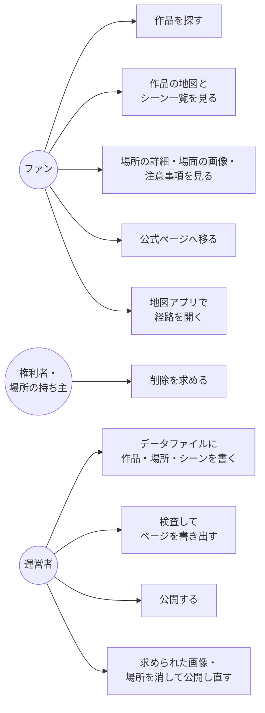
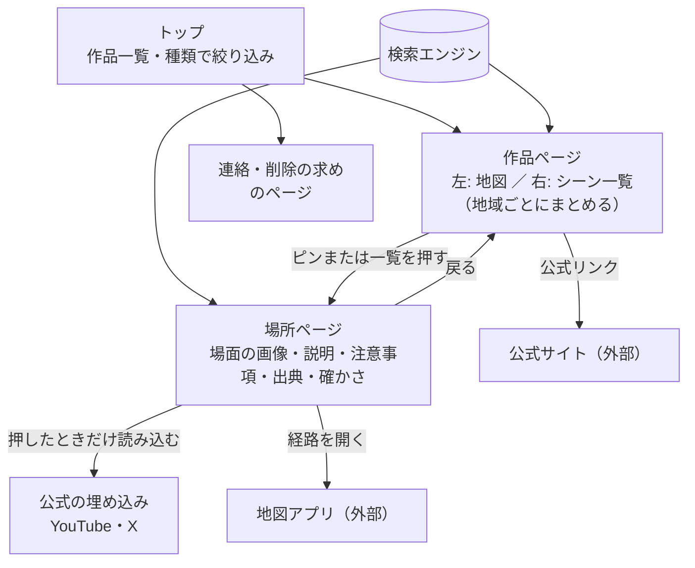
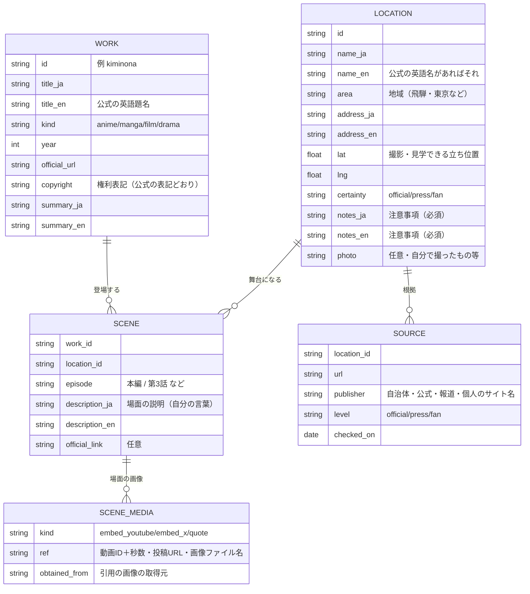

# SceneTrail（シーントレイル）仕様書

- 版: 0.5（作品の画像を載せる・最初は「君の名は。」だけ・ファンの調べも載せる、に変更。有識者レビュー6〜7回目で全員 LGTM。オーナー承認待ち）
- 作成: 2026-11-24
- レビューの記録: [review_log.md](review_log.md)

> **用語**
> - **聖地巡礼**: アニメ・漫画・映画・ドラマの舞台やロケ地を訪ねること。観光学では「コンテンツツーリズム」と呼ぶ
> - **ロケ地**: 映画やドラマを実際に撮影した場所
> - **フィルムコミッション（FC）**: 自治体などが置く、撮影の受け入れ窓口。公開してよいロケ地を案内していることが多い
> - **静的サイト**: あらかじめ作っておいた HTML をそのまま配るサイト。ログインやデータベースへの書き込みがない
> - **地理院タイル**: 国土地理院が配っている地図の画像。出典を書けば無料で使える
> - **埋め込み**: 公式の YouTube 動画や X の投稿を、自分のページの中に枠で表示すること。画像や動画は公式のサーバーから届き、こちらには置かない
> - **引用**: 著作権法32条で、条件を満たせば許可なく他人の著作物（ここでは場面の画像）を載せられること。条件は「自分の文章・写真が主で、引用する画像は従」「どこからが引用か分かる」「出典を書く」「必要な分だけ」「手を加えない」など
> - **確かさ**: その場所が作品の舞台だという情報の出どころの強さ。このサイトでは3段階で示す（4章）

---

## 1. 目的・背景

### 目的
作品の舞台になった場所を、**作品ごとの地図と、「どの場面か」の一覧**で案内する。
見る人が「どこに・どんな順で行けばよいか」と「現地で気を付けること」をひと目で分かるようにする。
**載せられる場所はできるだけ多く載せる**（公式の案内に無い場所も、確かさを示して載せる）。

### 背景
- 聖地巡礼の情報は、個人のブログや SNS にばらばらに載っていて、**どこまで確かな情報か分からない**ことが多い
- 場面と現地を見比べられないと、どこから撮ればよいか分からない。一方で、場面写真を並べたサイトの多くは引用の条件を満たしていない
- 迷惑行為（住宅地への立ち入り・混雑）で地元が困っている例がある

### このサイトの立ち位置（他との違い）
1. **場所ごとに確かさを示す。** 公式の案内・報道・ファンの調べを分けて表示し、出典を必ず付ける
2. **場面の画像は、公式の埋め込みと、条件を守った引用だけで出す**
3. **マナー・注意事項を場所ごとに必ず書く**

---

## 2. 利用者とユースケース

| 利用者 | したいこと |
|---|---|
| 巡礼を計画するファン（家で・スマホまたは PC） | 作品の舞台がどこにあるか、まとめて知りたい。回る順番を考えたい |
| 現地にいるファン（スマホ） | 次の場所がどこか、地図で確かめたい。場面と見比べたい。注意事項を見たい |
| 検索で来た人 | 「作品名 聖地」「作品名 ロケ地」で調べて、一覧を見たい |
| 海外から来るファン・旅行者 | 英語で「作品名 anime pilgrimage」と調べて、場所と注意事項を英語で読みたい |
| 権利者・場所の持ち主 | 画像や場所の掲載をやめてほしいときに、連絡して早く消してもらいたい |
| 運営者（オーナー＋Claude） | 作品・場所・シーンを登録して公開したい。削除の求めにすぐ応えたい |

---

## 3. 機能一覧

### 3.1 画面の流れ

### 3.2 機能（第1段階で作るもの）

| No | 機能 | 内容 |
|---|---|---|
| F1 | 作品一覧（トップ） | 作品を並べる。種類（アニメ・漫画・映画・ドラマ）で絞り込む。作品ごとに場所の数を出す（第1段階は1作品だが、増やせる作りにする） |
| F2 | 作品ページ | 作品の紹介文・公式リンク。**地図と、シーン一覧を並べて**出す（スマホでは地図が上、一覧が下）。場所が多いので、一覧は地域（例: 飛騨・東京）ごとにまとめ、地域で絞り込める |
| F3 | 地図と一覧の連動 | ピンを押すと一覧のその行が目立ち、行を押すと地図がその場所へ動く。ピンが重なる所はまとめて数を出し、寄ると分かれる |
| F4 | 場所ページ | 場所の名前・住所・登場する場面の説明・場面の画像（F12）・注意事項・出典・確かさ・公式リンク。場所ごとに URL を持つ |
| F5 | 経路を開く | 緯度経度を付けて地図アプリ（Google マップ等）を開くリンク |
| F6 | 注意事項の表示 | 場所ごとに、撮影の可否・営業時間・住宅地への配慮などを出す。サイト共通の「巡礼のマナー」ページも置く（日本の習慣を知らない海外の人にも分かるよう、私道に入らない・住民を撮らない・階段や道をふさいで撮らない・寺社の撮影の決まり、などを具体的に書く） |
| F7 | 出典と確かさの表示 | 場所ごとに、確かさ（4章の3段階）を文字とマークで出し、出典へのリンクと確かめた日を出す。作品ページの一覧でも確かさが分かり、確かさで絞り込める |
| F8 | 現地写真（任意） | 自分で撮った写真、または自由に使える写真（CC0 等）。撮影者・ライセンスを出す |
| F9 | データの検査と書き出し | データファイルを検査し（4章）、問題があれば**止めて**場所を示す。問題が無ければ静的ページを書き出す |
| F10 | 検索エンジン向け | 作品・場所ごとのタイトルと説明文、`sitemap.xml`、canonical |
| F11 | 日本語と英語 | すべてのページを日英で作る。日本語はサイト直下、英語は `/en/` の下に同じ並びで置く。言葉は URL で決め、自動に切り替え・転送しない。各ページに相手の言葉のページへのリンクと、canonical・hreflang（ja・en・x-default）を書く |
| F12 | 場面の画像 | 場所ページに、その場所の場面を (1) 公式の埋め込み（公式 YouTube の予告編などをその場面の秒数から再生／公式 X の投稿）、または (2) 引用の画像（6章の条件を守る）で出す。埋め込みは押したときだけ読み込む。作品ページの一覧には出さない |
| F13 | 連絡・削除の求め | 権利者・場所の持ち主・利用者が、画像や場所の削除・誤りを知らせる窓口のページ。受けた求めには決めた日数のうちに応え、削除の求めは確かめる前でも先に非公開にする |

### 3.3 第1段階で作らないもの（あとで考える）

- 利用者の投稿・口コミ・ログイン（ファンの調べは運営者が読んで載せる。投稿は受けない）
- 全国の地図（作品をまたいで一つの地図に出す）
- 現在地の表示、回る順番の自動提案
- 広告
- 「君の名は。」以外の作品（データの形は複数作品に対応させておく）

---

## 4. データ

作品・場所・シーンを分けて持つ。同じ場所が複数の作品に出ても、場所は一つだけ登録すればよい。

### 確かさ（3段階）

| 段階 | 出典 | 表示の例 |
|---|---|---|
| 公式（official） | 作品の公式・自治体・観光協会・FC が舞台と案内している | 「公式の案内あり」 |
| 報道（press） | 新聞・テレビ・出版社の記事で、監督・制作側の話や取材に基づいて舞台とされている | 「報道で紹介」 |
| ファンの調べ（fan） | ファンのブログ・SNS などで特定された。**別々の2人以上が同じ場所を挙げている**ものだけ載せる | 「ファンの調べ（公式の確認なし）」 |

- 場所の確かさは、付いている出典のうち最も強い段階にする
- ファンの調べから使うのは事実（場所・どの場面か）だけ。**その人の写真・比較画像・文章は使わない**
- 「モデルになったと言われる」程度の場所（監督が特定の場所ではないと話している等）は、そのことを説明に書く

### 載せない場所

確かさにかかわらず、次の場所は載せない。

- 個人宅、私有地、立入禁止の場所、関係者以外が入れない建物の中
- 店・施設で、撮影や巡礼の来訪を断っていると公表している所
- 線路内・車道の真ん中など、立ち位置に行くと危ない所（近くの安全な立ち位置があればそこを登録する）

### 検査（書き出しの前に必ず通す）

- 必須の項目が空でない（場所の注意事項・出典・確かさを含む）。**日本語と英語の両方がそろっている**（片方だけの作品・場所は書き出さずに止める）
- 確かさが出典と合っている（fan の場所は別のサイトの出典が2件以上ある）
- 緯度経度が日本の範囲に入っている（緯度と経度の入れ違いを見つける）
- ID が重複していない。シーンが指している作品・場所が存在する
- 場面の画像：埋め込みは公式のアカウント（作品データに登録したもの）の動画・投稿だけ。引用の画像は、取得元・権利表記があり、1場面1枚、決めた大きさ以下
- 現地写真の項目に、撮影者・ライセンスの無い画像が入っていない
- 書き出したあと、日英すべてのページについて、サイト内のリンク・画像・CSS が実在するファイルを指しているか確かめる（`/en/` は1階層深く、相対パスがずれやすい）
- 一つでも問題があれば書き出しを止め、どのファイルの何行目かを示す（**一部だけ書き出して成功扱いにしない**）

---

## 5. 非機能要件

| 区分 | 要件 |
|---|---|
| 性能 | スマホの回線（4G 相当）で、作品ページの一覧が 3 秒以内に出る（場所が 100 か所あっても）。地図が出る前でも一覧は読める。作品ページでは埋め込み・引用の画像を読み込まない |
| 端末 | スマホを優先する（現地で使うため）。幅 320px で崩れない |
| セキュリティ | 書き込みの入口が無い（静的サイト）。外部へのリンクには `rel="noopener noreferrer"`。外部から読み込むのは地図タイルと、利用者が押したあとの公式の埋め込みだけ |
| プライバシー | 公式の埋め込みは押すまで読み込まない（押す前に YouTube・X へ通信しない）。YouTube は `youtube-nocookie.com` を使う |
| 可用性 | 地図タイルや埋め込みが読めないときも、シーン一覧・住所・注意事項は表示される |
| 保守 | 公式リンク・出典リンク・埋め込みの動画や投稿の切れを確かめる道具を持つ（手動で月1回） |
| 削除への対応 | 削除の求めを受けてから、該当の画像・場所を **72 時間以内**に公開から外す。手順は1コマンドで済むようにする |
| 使いやすさ | 文字だけでも意味が通る（色だけで区別しない。確かさも文字で出す）。地図のピンにも名前を付ける |
| 検索 | 作品ページ・場所ページはそれぞれ独立した URL・タイトル・説明文を持つ |

---

## 6. 制約・前提

### 場面の画像

- 出し方は **(1) 公式の埋め込み** を先に探し、無い場面だけ **(2) 引用** にする
- 公式の埋め込みは、作品の公式・配給・制作会社のアカウントのものだけ。非公式の切り抜き動画・転載は埋め込まない
- 引用は次の条件をすべて守る
  - **主従**: 場所ページの主は自分の文章（場面の説明・行き方・注意事項）と現地写真で、場面の画像は見比べるための従。画像だけのページ・画像を並べた一覧（ギャラリー）は作らない
  - **区別**: 引用の画像は枠で囲み、「引用」と分かるようにする
  - **出典**: 画像のすぐ下に作品名と権利表記（公式の表記どおり）を出す
  - **必要な分だけ**: 1場面1枚。長辺 640px 以下
  - **手を加えない**: 文字やスタンプを載せない、色を変えない（大きさを変える・場面の外の黒帯を切るのは可）
  - **取得のしかた**: 公式サイト・公式 SNS が公開している画像か、正規に買った・借りた映像を再生した画面から取る。**コピーガードを外して取り出さない**（法律で禁じられている）。配信サービスの規約で画面の保存が禁じられているものからは取らない。他人のブログ・SNS の画像を写さない
- **引用の画像は Public リポジトリに入れない**（入れると削除しても履歴に残り、誰でも取り出せる）。非公開の置き場に置き、書き出しのときだけ取り込む（方法は設計書で決める）
- 公式ページへの普通のリンクは、相手の画像付きのカード（OGP の展開）にしない（埋め込みは上の条件で別に扱う）
- 削除の求めには、理由を問わずまず公開から外し、そのあと話を聞く

### 場所と情報

- 出典から使うのは事実（場所・話数・どの場面か）だけ。**説明文や一覧の並びを写さず、自分の言葉で書く**
- 英語の文は、機械翻訳をそのまま載せない。特に注意事項は、意味が正しく伝わるか日本語と見比べて確かめる。作品名は公式の英語題名を使い、無ければローマ字にする
- 作品名は案内のために使うが、公式と間違えられないよう全ページに「非公式のファンサイト」と書く
- 現地写真は自分で撮ったもの、または CC0・パブリックドメインのもの。人の顔・車のナンバーが写るものは使わない

### 仕組み

- 地図は地理院タイル（日本国内のみ）。出典「国土地理院」を表示する。海外の舞台は第1段階では扱わない
- 配信は GitHub Pages（Public リポジトリ）。ローカルで Web サーバーは立てず、自動テストは書き出した HTML を `file://` で開いて流す
- 運営者が一人で回せる量にする。最初は1作品で場所を多く載せるので、場所の追加は「データファイルに1件足して検査・書き出し」だけで済むようにする

---

## 7. 最初に載せる作品

| 種類 | 作品 | 英語題名 | 主な舞台 | 選んだ理由 |
|---|---|---|---|---|
| アニメ映画 | 君の名は。（2016） | Your Name. | 岐阜県飛騨市、東京都新宿区・港区など | 飛騨市が巡礼の案内を出している。海外でもよく知られ、ファンの調べも多い |

- 第1段階はこの1作品だけ。公式・報道・ファンの調べから、載せない場所（4章）を除いて**できるだけ多く**載せる
- 英語題名・権利表記は、データを作るときに公式の表記を確かめて決める
- 次の作品は、第1段階を公開したあとに決める（第0.4版の候補「男はつらいよ」「舞妓さんちのまかないさん」は保留）

---

## 8. 異常時の考え方（詳しくは設計書）

| 起きること | どうするか |
|---|---|
| 地図タイルが読めない | 地図の場所に「地図を読み込めませんでした」と出し、一覧・住所はそのまま表示する |
| 埋め込みの動画・投稿が消えた／読めない | 枠に「公式の動画を読み込めませんでした」と公式ページへのリンクを出す。月1回の確かめで見つけて直す |
| データファイルの誤り | 検査で止め、ファイル名と行を出す。前回の公開はそのまま残る |
| 公式・出典のリンク切れ | 確かめる道具で一覧にし、運営者が直す。切れたままの出典は「確認中」と表示する |
| 引用の画像の置き場に届かない | 書き出しを止める（画像の無いページを黙って公開しない）。前回の公開はそのまま残る |
| 削除の求め | 72 時間以内に該当の画像・場所を外して公開し直す。外したことを記録に残す |
| 書き出しが途中で落ちる | 書き出しは一時フォルダに作り、全部できてから入れ替える（半分だけ更新された状態を公開しない） |
