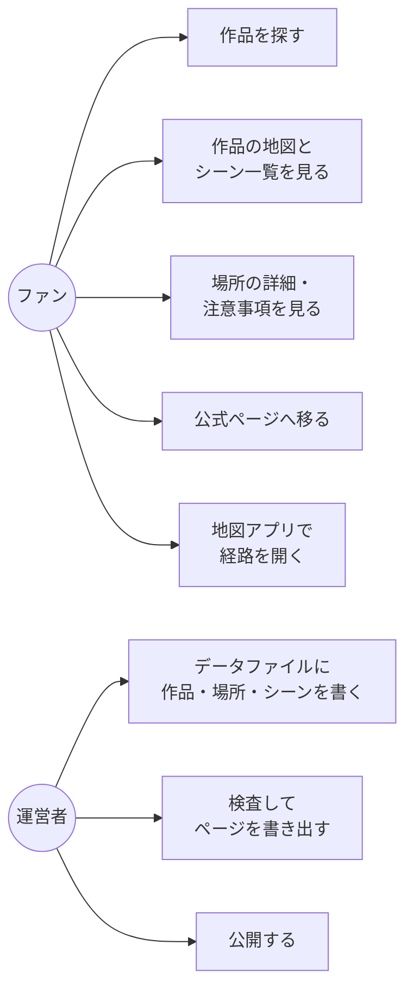
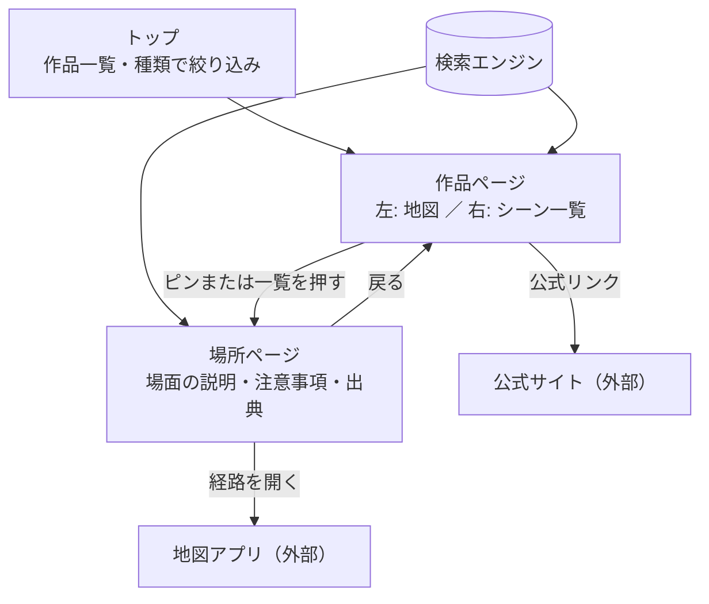
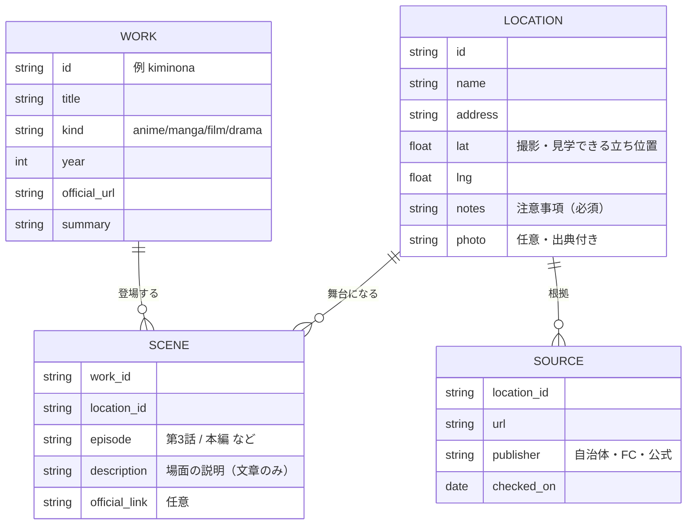

# シーンさんぽ（仮称）仕様書

- 版: 0.3（有識者レビュー3回目で全員 LGTM。オーナー承認待ち）
- 作成: 2026-11-24
- レビューの記録: [review_log.md](review_log.md)

> **用語**
> - **聖地巡礼**: アニメ・漫画・映画・ドラマの舞台やロケ地を訪ねること。観光学では「コンテンツツーリズム」と呼ぶ
> - **ロケ地**: 映画やドラマを実際に撮影した場所
> - **フィルムコミッション（FC）**: 自治体などが置く、撮影の受け入れ窓口。公開してよいロケ地を案内していることが多い
> - **静的サイト**: あらかじめ作っておいた HTML をそのまま配るサイト。ログインやデータベースへの書き込みがない
> - **地理院タイル**: 国土地理院が配っている地図の画像。出典を書けば無料で使える

---

## 1. 目的・背景

### 目的
作品の舞台になった場所を、**作品ごとの地図と、「第◯話のどの場面か」の一覧**で案内する。
見る人が「どこに・どんな順で行けばよいか」と「現地で気を付けること」をひと目で分かるようにする。

### 背景
- 聖地巡礼の情報は、個人のブログや SNS にばらばらに載っていて、**どこまで確かな情報か分からない**ことが多い
- 作品の場面写真を並べたサイトも多いが、多くは権利者の許可を取っていない
- 迷惑行為（住宅地への立ち入り・混雑）で地元が困っている例がある

### このサイトの立ち位置（他との違い）
1. **出典の付いた場所だけを載せる**（自治体・FC・公式の発表）
2. **作品の画像を載せない。** 公式ページへのリンクで案内する
3. **マナー・注意事項を場所ごとに必ず書く**

---

## 2. 利用者とユースケース

| 利用者 | したいこと |
|---|---|
| 巡礼を計画するファン（家で・スマホまたは PC） | 作品の舞台がどこにあるか、まとめて知りたい。回る順番を考えたい |
| 現地にいるファン（スマホ） | 次の場所がどこか、地図で確かめたい。注意事項を見たい |
| 検索で来た人 | 「作品名 聖地」「作品名 ロケ地」で調べて、一覧を見たい |
| 運営者（オーナー＋Claude） | 作品・場所・シーンを登録して公開したい |

---

## 3. 機能一覧

### 3.1 画面の流れ

### 3.2 機能（第1段階で作るもの）

| No | 機能 | 内容 |
|---|---|---|
| F1 | 作品一覧（トップ） | 作品を並べる。種類（アニメ・漫画・映画・ドラマ）で絞り込む。作品ごとに場所の数を出す |
| F2 | 作品ページ | 作品の紹介文・公式リンク。**地図と、シーン一覧を並べて**出す（スマホでは地図が上、一覧が下） |
| F3 | 地図と一覧の連動 | ピンを押すと一覧のその行が目立ち、行を押すと地図がその場所へ動く |
| F4 | 場所ページ | 場所の名前・住所・登場する話数と場面の説明（文章のみ）・注意事項・出典・公式リンク。場所ごとに URL を持つ |
| F5 | 経路を開く | 緯度経度を付けて地図アプリ（Google マップ等）を開くリンク |
| F6 | 注意事項の表示 | 場所ごとに、撮影の可否・営業時間・住宅地への配慮などを出す。サイト共通の「巡礼のマナー」ページも置く |
| F7 | 出典の表示 | 場所ごとに、情報の出どころ（自治体・FC・公式）へのリンクと、確かめた日を出す |
| F8 | 現地写真（任意） | 自分で撮った写真、または自由に使える写真（CC0 等）。撮影者・ライセンスを出す |
| F9 | データの検査と書き出し | データファイルを検査し（下の「4. データ」）、問題があれば**止めて**場所を示す。問題が無ければ静的ページを書き出す |
| F10 | 検索エンジン向け | 作品・場所ごとのタイトルと説明文、`sitemap.xml`、canonical |

### 3.3 第1段階で作らないもの（あとで考える）

- 利用者の投稿・口コミ・ログイン
- 全国の地図（作品をまたいで一つの地図に出す）
- 現在地の表示、回る順番の自動提案
- 英語版
- 広告

---

## 4. データ

作品・場所・シーンを分けて持つ。同じ場所が複数の作品に出ても、場所は一つだけ登録すればよい。

### 検査（書き出しの前に必ず通す）

- 必須の項目が空でない（場所の注意事項・出典を含む）
- 緯度経度が日本の範囲に入っている（緯度と経度の入れ違いを見つける）
- ID が重複していない。シーンが指している作品・場所が存在する
- 画像の項目に、作品の画像らしいもの（出典のない画像・公式ドメインの画像）が入っていない
- 一つでも問題があれば書き出しを止め、どのファイルの何行目かを示す（**一部だけ書き出して成功扱いにしない**）

---

## 5. 非機能要件

| 区分 | 要件 |
|---|---|
| 性能 | スマホの回線（4G 相当）で、作品ページの一覧が 3 秒以内に出る。地図が出る前でも一覧は読める |
| 端末 | スマホを優先する（現地で使うため）。幅 320px で崩れない |
| セキュリティ | 書き込みの入口が無い（静的サイト）。外部へのリンクには `rel="noopener noreferrer"`。外部の画像は読み込まない（地図タイルを除く） |
| 可用性 | 地図タイルが読めないときも、シーン一覧・住所・注意事項は表示される |
| 保守 | 公式リンク・出典リンクの切れを確かめる道具を持つ（手動で月1回） |
| 使いやすさ | 文字だけでも意味が通る（色だけで区別しない）。地図のピンにも名前を付ける |
| 検索 | 作品ページ・場所ページはそれぞれ独立した URL・タイトル・説明文を持つ |

---

## 6. 制約・前提

- **作品の画像は使わない。** 場面写真・コマ・ポスター・ロゴをリポジトリに置かず、外から直接読み込みもしない。公式ページへのリンクだけにする
- 公式ページへのリンクを、相手の画像付きのカード（OGP の展開）にしない
- **載せる場所は、自治体・FC・公式が公開している場所だけ。** 個人宅・私有地・立入禁止の場所は、公開されていても載せない
- 出典から使うのは事実（場所・話数・どの場面か）だけ。**説明文や一覧の並びを写さず、自分の言葉で書く**
- 作品名は案内のために使うが、公式と間違えられないよう全ページに「非公式のファンサイト」と書く
- 現地写真は自分で撮ったもの、または CC0・パブリックドメインのもの。人の顔・車のナンバーが写るものは使わない
- 地図は地理院タイル（日本国内のみ）。出典「国土地理院」を表示する。海外の舞台は第1段階では扱わない
- 配信は GitHub Pages（Public リポジトリ）。ローカルで Web サーバーは立てず、自動テストは書き出した HTML を `file://` で開いて流す
- 運営者が一人で回せる量にする（最初は 3 作品・各 5 か所程度）

---

## 7. 最初に載せる作品（候補）

種類が偏らないように、**自治体が公式に舞台・ロケ地を案内している作品**から選ぶ。
実際に載せる場所は、データを作るときに出典を一つずつ確かめて決める。

| 種類 | 作品（候補） | 主な舞台 | 選んだ理由 |
|---|---|---|---|
| アニメ映画 | 君の名は。 | 岐阜県飛騨市・東京都新宿区など | 飛騨市が巡礼の案内を出している |
| 映画 | 男はつらいよ | 東京都葛飾区柴又など | 葛飾区が舞台の案内を出している。長く続く作品で場所が多い |
| ドラマ | 舞妓さんちのまかないさん | 京都市 | 京都市の観光サイトが撮影場所と場面を一覧にしている |

---

## 8. 異常時の考え方（詳しくは設計書）

| 起きること | どうするか |
|---|---|
| 地図タイルが読めない | 地図の場所に「地図を読み込めませんでした」と出し、一覧・住所はそのまま表示する |
| データファイルの誤り | 検査で止め、ファイル名と行を出す。前回の公開はそのまま残る |
| 公式・出典のリンク切れ | 確かめる道具で一覧にし、運営者が直す。切れたままの出典は「確認中」と表示する |
| 書き出しが途中で落ちる | 書き出しは一時フォルダに作り、全部できてから入れ替える（半分だけ更新された状態を公開しない） |
