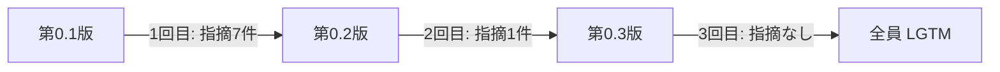

# 仕様レビューの記録

対象: [01_spec.md](01_spec.md)　実施: 2026-11-24（仮想レビュー）

## レビューした人（役割）

| 役割 | 見るところ |
|---|---|
| A. 観光学の研究者（コンテンツツーリズム・地域連携の実績） | 地元との関係、迷惑行為、ファンの実際の動き方 |
| B. 著作権・エンタメ法務の弁護士（作品の権利処理の実績） | 画像・作品名・出典の扱い |
| C. Web 地図・静的サイトのエンジニア（地図サービス運用の実績） | 地図・データ・公開の仕組み、壊れ方 |

指摘として残すのは「どこが・どう壊れるか」を言えるものだけにした。

## 1回目（第0.1版。ChatGPT の案をこの環境に合わせたもの）

| # | 誰 | 指摘（どこが・どう壊れるか） | 直したところ |
|---|---|---|---|
| 1 | B | 「公式画像へのリンク」でも、リンクを画像付きのカード（OGP の展開）にすると、相手の画像を自分のページに出すことになり、許可なく載せたのと同じ状態になる | 6章: カードにしない。検査で公式ドメインの画像を弾く（4章） |
| 2 | B | ドラマのロケ地には、撮影を許した一般の店や家が含まれる。公開されていない場所を探し当てて載せると、持ち主に迷惑がかかり、苦情や削除の求めにつながる | 6章: 自治体・FC・公式が公開した場所だけ。個人宅・私有地は公開されていても載せない |
| 3 | B | 作品名やタイトルを大きく出すと、公式サイトと間違えられる | 6章: 全ページに「非公式のファンサイト」 |
| 4 | A | 鎌倉高校前の踏切のように、混雑や住宅地への立ち入りで地元が困った例がある。場所だけ載せるとそれを後押しする | F6: 注意事項を場所ごとに必須に。マナーのページ |
| 5 | A | 現地ではスマホで見る。地図が重くて一覧が出ないと、駅前で立ち往生する | 5章: スマホ優先、地図より先に一覧が読める、幅 320px |
| 6 | C | 緯度経度は「被写体」と「撮る人が立つ位置」で数十 m ずれる。被写体の位置だと線路の上や川の中を指すことがある | 4章: 緯度経度は「撮影・見学できる立ち位置」と決める |
| 7 | C | 緯度と経度の入れ違い・打ち間違いは、地図に出すまで気付けず、海の上にピンが立つ | 4章: 日本の範囲の検査。問題があれば書き出しを止める |

## 2回目（第0.2版）

| # | 誰 | 指摘 | 直したところ |
|---|---|---|---|
| 8 | B | 7章で使う予定の自治体のロケ地一覧は、説明文や選び方・並べ方にも著作権がありうる（編集著作物）。そのまま写すと、出典を書いても転載になる | 6章: 使うのは事実（場所・話数・場面）だけで、文は自分の言葉で書く |

A・C は指摘なし。

## 3回目（第0.3版）

指摘なし。A・B・C 全員 LGTM。

## 検討したが指摘にしなかったもの

- 現在地の表示（A）: あると便利だが、無くても経路を開くリンク（F5）で地図アプリの現在地が使える。壊れる話ではないので第2段階へ
- 季節・時間帯の情報（A）: 作品によって必要さが違う。注意事項の欄に書けば足りる
