# 仕様レビューの記録

対象: [01_spec.md](01_spec.md)　実施: 2026-11-24（仮想レビュー）

## レビューした人（役割）

| 役割 | 見るところ |
|---|---|
| A. 観光学の研究者（コンテンツツーリズム・地域連携の実績） | 地元との関係、迷惑行為、ファンの実際の動き方 |
| B. 著作権・エンタメ法務の弁護士（作品の権利処理の実績） | 画像・作品名・出典の扱い |
| C. Web 地図・静的サイトのエンジニア（地図サービス運用の実績） | 地図・データ・公開の仕組み、壊れ方 |

指摘として残すのは「どこが・どう壊れるか」を言えるものだけにした。

```mermaid
flowchart LR
  v1[第0.1版] -->|1回目: 指摘7件| v2[第0.2版]
  v2 -->|2回目: 指摘1件| v3[第0.3版]
  v3 -->|3回目: 指摘なし| v3ok[全員 LGTM]
  v3ok -->|日英2言語に変更| v4a[第0.4版 案]
  v4a -->|4回目: 指摘2件| v4[第0.4版]
  v4 -->|5回目: 指摘なし| ok[全員 LGTM]
  ok -->|画像を載せる・1作品・ファンの調べ<br/>に変更| v5a[第0.5版 案]
  v5a -->|6回目: 指摘9件| v5[第0.5版]
  v5 -->|7回目: 指摘なし| ok2[全員 LGTM]
```

## 1回目（第0.1版。ChatGPT の案をこの環境に合わせたもの）

| # | 誰 | 指摘（どこが・どう壊れるか） | 直したところ |
|---|---|---|---|
| 1 | B | 「公式画像へのリンク」でも、リンクを画像付きのカード（OGP の展開）にすると、相手の画像を自分のページに出すことになり、許可なく載せたのと同じ状態になる | 6章: カードにしない。検査で公式ドメインの画像を弾く（4章） |
| 2 | B | ドラマのロケ地には、撮影を許した一般の店や家が含まれる。公開されていない場所を探し当てて載せると、持ち主に迷惑がかかり、苦情や削除の求めにつながる | 6章: 自治体・FC・公式が公開した場所だけ。個人宅・私有地は公開されていても載せない |
| 3 | B | 作品名やタイトルを大きく出すと、公式サイトと間違えられる | 6章: 全ページに「非公式のファンサイト」 |
| 4 | A | 鎌倉高校前の踏切のように、混雑や住宅地への立ち入りで地元が困った例がある。場所だけ載せるとそれを後押しする | F6: 注意事項を場所ごとに必須に。マナーのページ |
| 5 | A | 現地ではスマホで見る。地図が重くて一覧が出ないと、駅前で立ち往生する | 5章: スマホ優先、地図より先に一覧が読める、幅 320px |
| 6 | C | 緯度経度は「被写体」と「撮る人が立つ位置」で数十 m ずれる。被写体の位置だと線路の上や川の中を指すことがある | 4章: 緯度経度は「撮影・見学できる立ち位置」と決める |
| 7 | C | 緯度と経度の入れ違い・打ち間違いは、地図に出すまで気付けず、海の上にピンが立つ | 4章: 日本の範囲の検査。問題があれば書き出しを止める |

## 2回目（第0.2版）

| # | 誰 | 指摘 | 直したところ |
|---|---|---|---|
| 8 | B | 7章で使う予定の自治体のロケ地一覧は、説明文や選び方・並べ方にも著作権がありうる（編集著作物）。そのまま写すと、出典を書いても転載になる | 6章: 使うのは事実（場所・話数・場面）だけで、文は自分の言葉で書く |

A・C は指摘なし。

## 3回目（第0.3版）

指摘なし。A・B・C 全員 LGTM。

## 4回目（日英2言語に変えた案。2026-11-24 オーナー決定）

| # | 誰 | 指摘（どこが・どう壊れるか） | 直したところ |
|---|---|---|---|
| 9 | A | 海外から来る人は日本の習慣を知らないことが多い。京都の祇園では私道への立ち入りや舞妓さんへのつきまといが問題になり、地元が立ち入り禁止の掲示を出している。最初の候補に舞妓さんのドラマがあるので、英語で具体的に書かないと迷惑を後押しする | F6: マナーのページに、私道・人を追って撮らない・寺社の撮影の決まりを具体的に書く |
| 10 | C | 英語は `/en/` の下で1階層深くなるため、相対パスの画像・CSS・リンクが日本語のページと同じ書き方だと切れる（ImmersaMap でも同じ注意が要った） | 4章: 書き出し後に日英すべてのページのリンク・画像・CSS を確かめる |

B は指摘なし（英語の作品紹介を公式の英語あらすじから写さないことは、#8 の決まりで足りる）。

## 5回目（第0.4版）

指摘なし。A・B・C 全員 LGTM。

## 6回目（オーナーの変更を入れた案。2026-11-24 オーナー決定）

オーナーの変更: (1) 作品の画像を載せる（公式の埋め込み＋引用の両方）(2) 最初の作品は「君の名は。」だけ (3) 場所はファンの調べも含めてできるだけ多く載せる

| # | 誰 | 指摘（どこが・どう壊れるか） | 直したところ |
|---|---|---|---|
| 11 | B | 引用の画像を Public リポジトリに入れると、削除の求めでファイルを消しても git の履歴に残り、誰でも取り出せる。「消した」と言えない | 6章: 引用の画像は Public リポジトリに入れず、非公開の置き場から書き出し時に取り込む |
| 12 | B | 円盤や配信の画面をコピーガードを外して取り出すと、私的な複製でも違法になる。そこから作った画像は引用の条件を満たしても使えない | 6章: 取得のしかた（公式の公開画像か、コピーガードを外さない再生画面。規約で禁じる配信からは取らない） |
| 13 | B | 連絡先が無いと、権利者はいきなり GitHub に削除の申し立て（DMCA）をし、リポジトリごと止められることがある | F13: 連絡・削除の求めのページ。5章: 72 時間以内に外す。6章: 先に外してから話を聞く |
| 14 | B | 作品ページに場面の画像を並べると、画像が主のギャラリーになり、主従の条件が崩れる | F12・6章: 画像は場所ページだけ、1場面1枚、640px 以下。ギャラリーは作らない |
| 15 | A | ファン1人の特定は間違いがある。間違った場所を載せると、関係ない住宅地を人がうろつくことになる | 4章: ファンの調べは別々の2人以上が挙げたものだけ。確かさを3段階で示す（F7） |
| 16 | A | 公式の案内が無い場所には、住宅街の中の階段や店が多い。巡礼の来訪を断っている店も載ってしまう | 4章「載せない場所」: 私有地・来訪を断る店・危ない立ち位置。F6: 階段や道をふさいで撮らない |
| 17 | C | 「できるだけ多く」で新宿・四谷あたりにピンが密集し、重なって押せない。一覧も長くなり、目的の場所が探せない | F2・F3: 地域ごとにまとめ・絞り込み、重なるピンはまとめて表示。5章: 100 か所でも 3 秒 |
| 18 | C | YouTube の埋め込みは1つで 1MB 前後を読み、開いただけで Google に通信する。一覧に並べると重く、断りなく外部へ通信する | F12・5章: 押したときだけ読み込む。`youtube-nocookie.com`。作品ページでは読み込まない |
| 19 | C | 引用の画像を非公開の置き場から取り込む作りでは、置き場に届かないと画像の無いページが黙って公開される | 8章: 置き場に届かなければ書き出しを止める |

## 7回目（第0.5版）

指摘なし。A・B・C 全員 LGTM。

## 検討したが指摘にしなかったもの

- X の埋め込みが仕様の変更で出なくなることがある（C）: 8章の「埋め込みが読めない」と月1回の確かめ（5章 保守）で足りる

- 住所の英語表記（C）: 並び順の違いで読みにくくなるが、経路は緯度経度のリンク（F5）で開くので迷わない。表記の決まりは設計書で決める

- 現在地の表示（A）: あると便利だが、無くても経路を開くリンク（F5）で地図アプリの現在地が使える。壊れる話ではないので第2段階へ
- 季節・時間帯の情報（A）: 作品によって必要さが違う。注意事項の欄に書けば足りる
