# SceneTrail UI 設計（画面遷移・ワイヤーフレーム）

- 版: 0.1（有識者レビュー2回目で全員 LGTM。オーナー承認待ち）
- 作成: 2026-11-24
- もとにした仕様: [../spec/01_spec.md](../spec/01_spec.md) 第0.5版
- レビューの記録: [review_log.md](review_log.md)

> **用語**
> - **ワイヤーフレーム**: 画面に何をどの順で置くかだけを決めた下書き。色・字体などの見た目は決めない（実装のときに決める）
> - **チップ**: 押すと選ばれた／外れたが切り替わる小さなボタン。絞り込みに使う
> - **クラスタ**: 地図でピンが重なる所を、数を書いた1つの丸にまとめたもの。寄せると分かれる
> - **ポップアップ**: 地図のピンを押したときに、ピンの横に出る小さな説明の枠

画面の写真は `docs/ui/wireframes/*.html` を `src/tools/render_wireframes.py` で撮ったもの（スマホは幅 375px、PC は幅 1280px）。

---

## 1. 画面の一覧

| No | 画面 | URL（日本語／英語） | 内容 |
|---|---|---|---|
| W1 | トップ | `/`／`/en/` | 作品一覧・種類で絞り込み・マナーへの入口 |
| W2 | 作品ページ | `/works/kiminona/`／`/en/works/kiminona/` | 地図とシーン一覧。地域・確かさで絞り込み |
| W3 | 場所ページ | `/places/<場所ID>/`／`/en/places/<場所ID>/` | 場面の画像（引用または埋め込み）・説明・注意事項・行き方・出典 |
| W4 | 巡礼のマナー | `/manners/`／`/en/manners/` | 住宅地・寺社・駅・店での決まり |
| W5 | 連絡・削除の求め | `/contact/`／`/en/contact/` | 削除・誤りを知らせる窓口。外したものの記録 |
| W6 | このサイトについて | `/about/`／`/en/about/` | 非公式であること・確かさの3段階の説明・画像の扱い（引用の考え方） |

- URL の細かい形（場所 ID の付け方など）は設計書で決める。上は並びの案
- 場所ページは作品の下に置かない（同じ場所が別の作品にも出るため）。パンくずは来た作品を出す

## 2. 画面の流れ

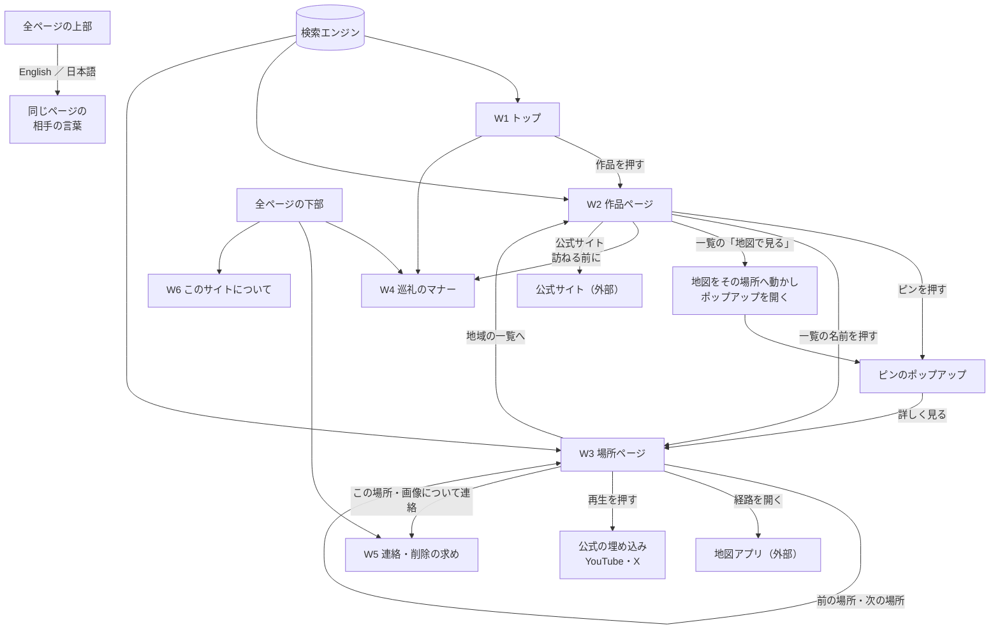

## 3. 全ページ共通

- 上部: サイト名（トップへ）、言葉の切り替え（**同じページの**相手の言葉へ。トップへ飛ばさない）
- その下に1行: 「非公式のファンサイトです。作品の公式とは関係ありません。」（英語は "Unofficial fan site. Not affiliated with the official works."）
- 下部: 非公式の表示、巡礼のマナー・このサイトについて・連絡・削除の求めへのリンク、地図の出典「国土地理院」
- 外へのリンクには「↗」を付け、外へ出ることが分かるようにする
- 色だけで区別しない：選ばれたチップには「✓」、確かさは「◆ ● ▲」のマークと文字、ファンの調べは枠を点線にする

## 4. 画面ごと

### W1 トップ

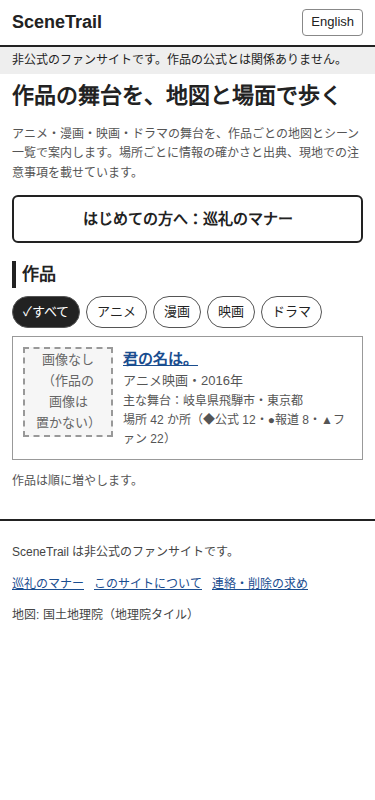

- 作品のカードには、作品の画像を出さない（引用の条件「主従」を満たせないため。仕様 6章）
- カードに場所の数を確かさごとに出す（例: ◆公式 12・●報道 8・▲ファン 22）
- 「はじめての方へ：巡礼のマナー」を作品一覧より上に置く

### W2 作品ページ

| スマホ（幅 375px） | PC（幅 1280px） |
|---|---|
| 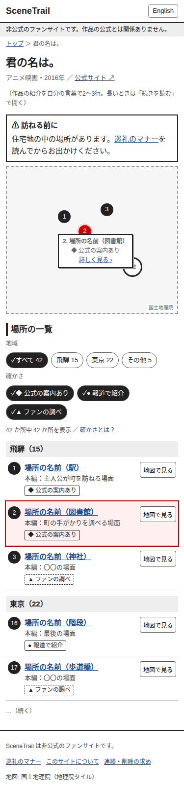 | 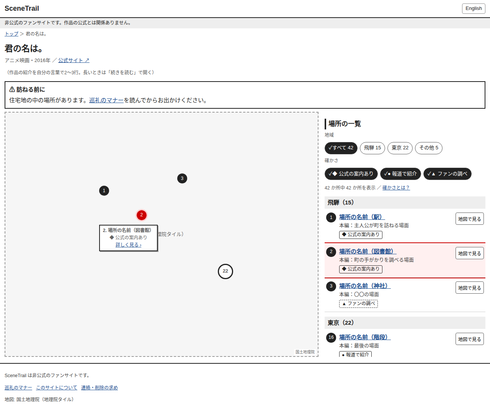 |

英語（スマホ）: 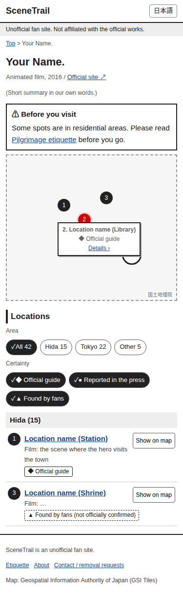

**並び（スマホ）**: パンくず → 題名・種類・年・公式サイト → 紹介（2〜3行、続きは開く） → 「訪ねる前に」の枠 → 地図 → 絞り込み → 地域ごとの一覧

**並び（PC, 幅 900px 以上）**: 上は同じ。その下を左に地図（画面に固定）、右に一覧（一覧だけ縦に流れる）

**動き**

| 操作 | どうなるか |
|---|---|
| ピンを押す | ピンが赤くなり、ポップアップ（番号・名前・確かさ・「詳しく見る」）が出る。PC では一覧のその行も目立たせ、見える位置まで流す。スマホでは一覧は動かさない（地図から一覧が見えないため） |
| 一覧の名前を押す | 場所ページへ移る |
| 一覧の「地図で見る」 | 地図をその場所へ動かしてポップアップを開く。スマホでは地図が見える位置まで画面を戻す |
| 重なったピン（クラスタ）を押す | 寄せて分ける |
| 地域のチップ | 1つだけ選べる（すべて／飛騨／東京／その他）。地図もその地域の範囲に合わせる |
| 確かさのチップ | いくつでも選べる。全部外したら「全部選ぶ」に戻す |
| 絞り込み | 一覧の上に「42 か所中 15 か所を表示」と出す。地図のピンも同じだけにする。選んだ状態は URL（`?area=hida` 等）に残し、戻ったとき・共有したときに同じ表示になる |

- 番号は作品の中で通し番号（データで運営者が並び順を決める。同じ地域の中は回りやすい順）。番号はピン・一覧・場所ページで同じ
- 一覧は HTML に最初から全部書いておく（地図の JavaScript が動かなくても読める。仕様 5章）
- 一覧に場面の画像は出さない（仕様 F12）

### W3 場所ページ

| 引用の画像（スマホ） | 引用の画像（PC） | 公式の埋め込み（スマホ） |
|---|---|---|
| 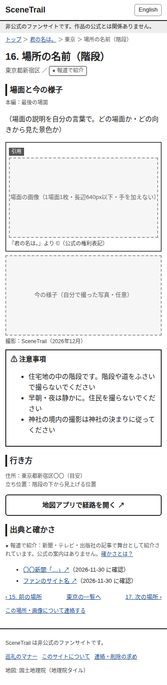 | 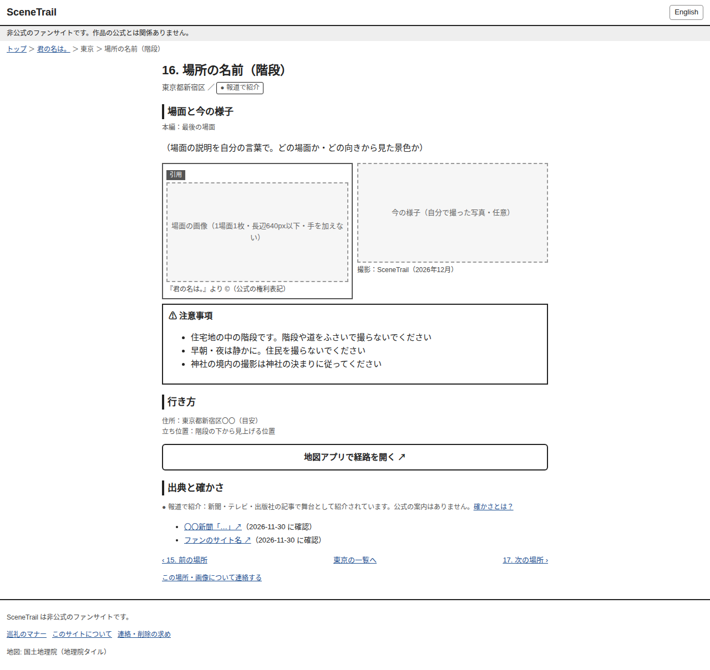 | 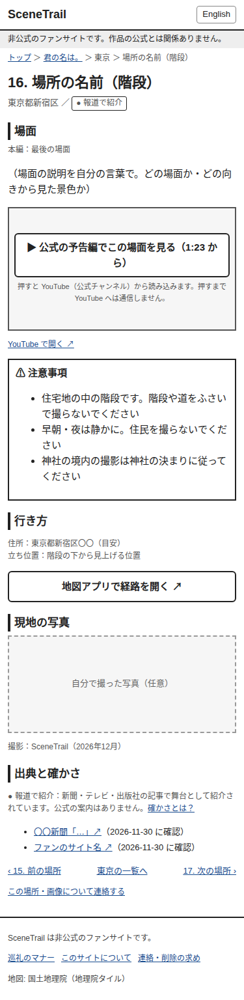 |

**並び**: パンくず（トップ ＞ 作品 ＞ 地域 ＞ 場所） → 番号・名前・住所（区市町村まで）・確かさ → **場面と今の様子**（話数 → 自分の言葉の説明 → 場面の画像と今の写真を並べる） → **注意事項** → **行き方**（住所・立ち位置・経路を開く） → **出典と確かさ** → 前・次の場所／地域の一覧へ → 「この場所・画像について連絡する」

- 自分の説明を画像より先に置き、今の様子の写真と並べて「見比べる」形にする（引用の主従。レビュー #1）
- 引用の画像は枠で囲み、左上に「引用」、すぐ下に作品名と権利表記
- 場面の画像も今の写真も無い場所は、説明の文だけにする（枠を空のまま出さない）
- 埋め込みは押すまで何も読み込まない。ボタンに公式のチャンネル名・何秒からかを書き、「押すと YouTube から読み込みます」と出す。横に「YouTube で開く ↗」
- 注意事項は経路のボタンより上に置く（経路だけ押して注意を読まずに行くのを防ぐ）
- 前・次は作品の通し番号の順

### W4 巡礼のマナー

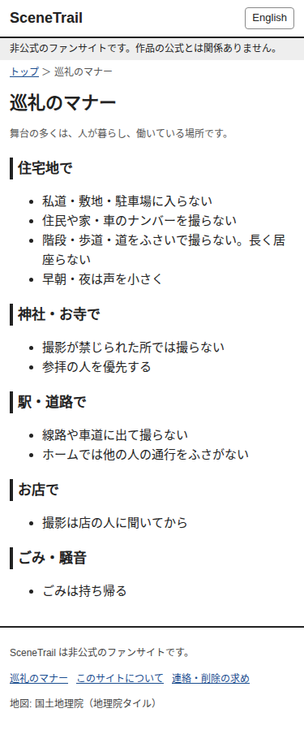

- 住宅地・神社とお寺・駅と道路・お店・ごみと騒音に分け、短い箇条書きで具体的に書く。英語は日本の習慣を知らない人向けに理由も1行足す（本文は実装時に書く）

### W5 連絡・削除の求め

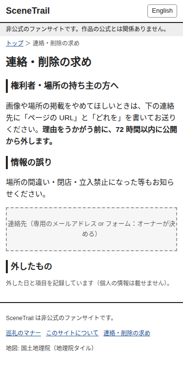

- 「理由をうかがう前に 72 時間以内に外す」をはっきり書く
- 外したもの（日付と項目）の記録を出す
- **連絡の手段はオーナーが決める**（下の「決めてほしいこと」）

### W6 このサイトについて

- 文章だけのページ（W4 と同じ作り）なので、ワイヤーフレームは省いた。非公式であること・確かさの3段階・画像の扱い（引用と埋め込みの考え方）・削除の求めへの対応を書く

### 異常時の表示

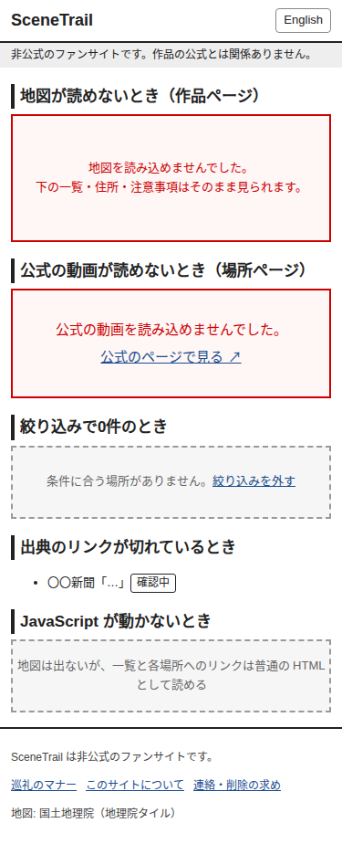

| 起きること | 表示 |
|---|---|
| 地図が読めない | 地図の枠に「地図を読み込めませんでした。下の一覧・住所・注意事項はそのまま見られます。」 |
| 公式の動画が読めない | 埋め込みの枠に「公式の動画を読み込めませんでした」と公式ページへのリンク |
| 絞り込みで0件 | 「条件に合う場所がありません」と「絞り込みを外す」 |
| 出典のリンクが切れている | その出典に「確認中」 |
| JavaScript が動かない | 地図は出ないが、一覧と各場所へのリンクは読める |

## 5. 決めてほしいこと（オーナー）

| 項目 | 案 | おすすめ |
|---|---|---|
| 連絡・削除の求めの手段 | (a) このサイト専用のメールアドレス（新しく作る） (b) Google フォーム (c) GitHub の issue | (a)＋(b)。個人のメールアドレスを出さずに済み、権利者は普通のメールで送れる。(c) は GitHub のアカウントが要り、求めの中身が公開される |
