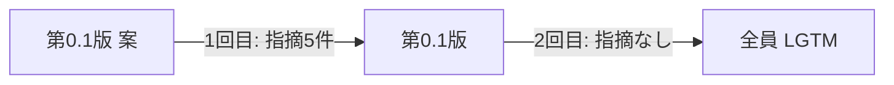

# UI レビューの記録

対象: [01_ui.md](01_ui.md)　実施: 2026-11-24（仮想レビュー。画面写真を順に見て行った）

## レビューした人（役割）

| 役割 | 見るところ |
|---|---|
| D. 旅行・観光案内アプリの UX デザイナー（街歩きアプリの実績） | 現地でスマホを片手に使えるか、迷わないか |
| E. 著作権・エンタメ法務の弁護士（仕様レビューの B と同じ立場） | 引用の画像の置き方が条件を満たすか |
| F. Web アクセシビリティと地図 UI のエンジニア | 色だけに頼らないか、地図と一覧のつながり、狭い画面 |

指摘として残すのは「どこが・どう壊れるか」を言えるものだけにした。

## 1回目

| # | 誰 | 指摘（どこが・どう壊れるか） | 直したところ |
|---|---|---|---|
| 1 | E | 場所ページで「場面」の見出しのすぐ下に場面の画像が大きく出て、自分の説明がその下にある。今の写真は離れた別の節。これでは画像が主に見え、引用の「主従」を問われたときに説明しにくい | W3: 説明を画像より先に置き、場面の画像と今の写真を並べて「場面と今の様子」にする。画像も写真も無いときは文だけ |
| 2 | F | 絞り込みのチップは、選ばれているかどうかが黒い塗りだけで分かれる。色の見分けにくい人や白黒の印刷では区別できない（仕様 5章「色だけで区別しない」に反する） | 共通: 選ばれたチップに「✓」。実装では `aria-pressed` を付ける |
| 3 | D | スマホでは地図が上・一覧が下なので、ピンを押して「一覧の行が目立つ」だけだと、何も起きないように見える（目立った行は画面の外） | W2: ピンを押すとポップアップ（番号・名前・確かさ・詳しく見る）。スマホでは一覧を動かさない |
| 4 | D | 一覧で行を押すと「地図が動く」案だと、スマホでは地図が画面の外にあり、動いたことが分からない。場所ページへ行く手段も分かりにくい | W2: 名前を押すと場所ページ、「地図で見る」で地図へ戻してポップアップ。仕様 F3 の「行を押すと地図が動く」は「地図で見る」で満たす |
| 5 | F | 絞り込みの状態がページの中だけだと、場所ページから戻ったときに外れ、42 か所の一覧の頭からやり直しになる（現地で何度も行き来する） | W2: 絞り込みを URL に残す |

## 2回目

指摘なし。D・E・F 全員 LGTM。

## 検討したが指摘にしなかったもの

- 英語の確かさの表示 "Found by fans (not officially confirmed)" が長い（F）: 幅 320px で確かめたところ、横にはみ出さず2行にもならなかった
- トップの作品カードに画像が無いと寂しい（D）: 引用の条件で作品画像はトップに出せない（仕様 6章）。見た目は実装で整える
- 番号を回る順にすると、仕様 3.3 の「回る順番の自動提案はしない」とぶつかる（D）: 自動ではなく運営者がデータで並べるだけなので、ぶつからない
